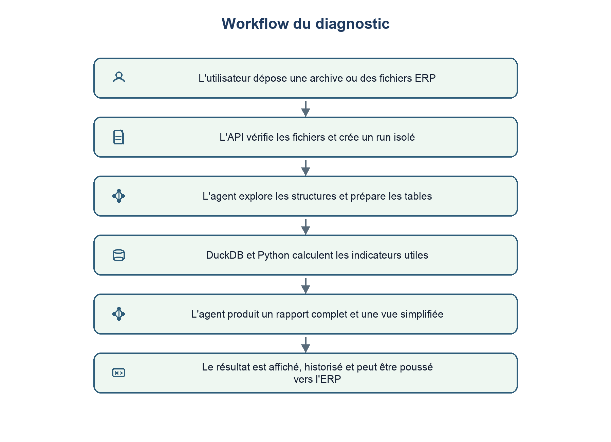
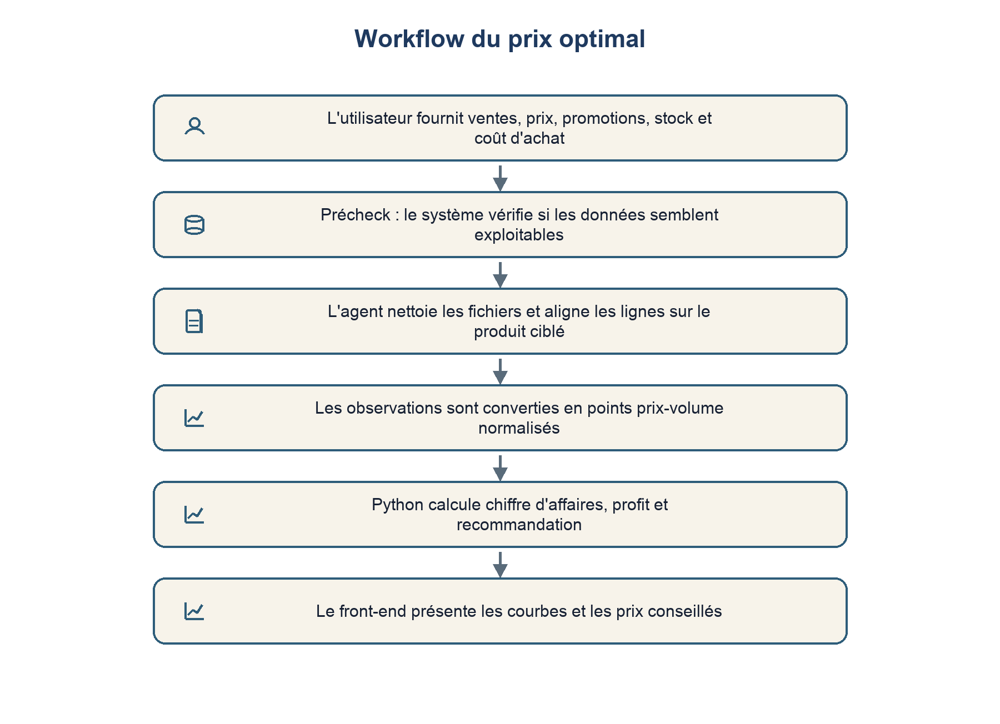
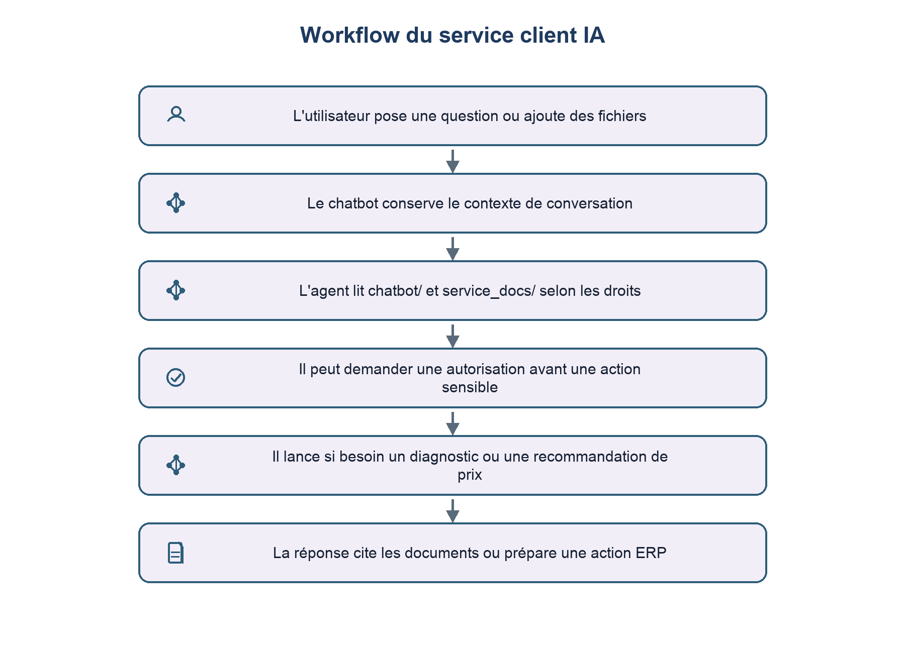
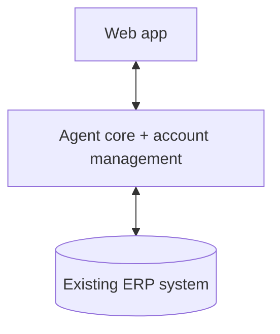
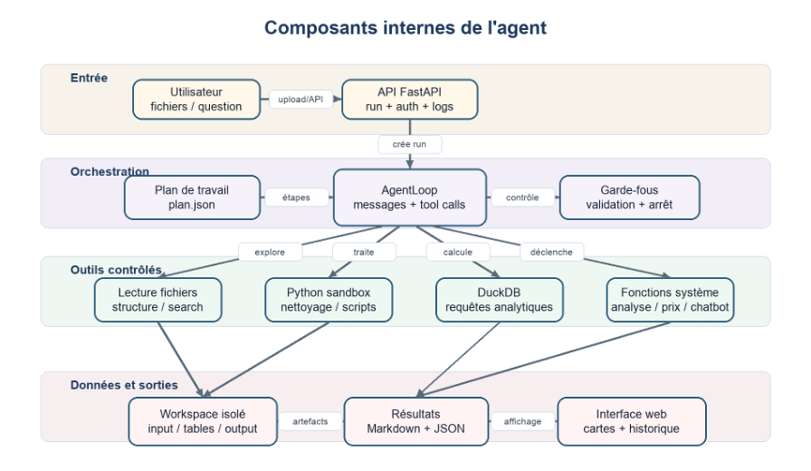
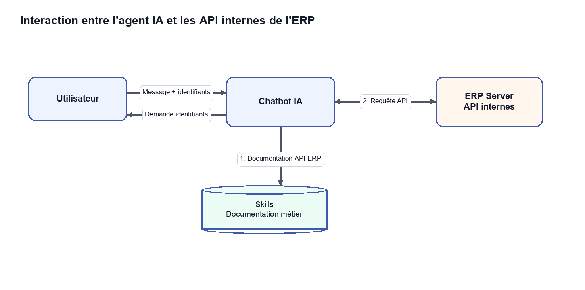
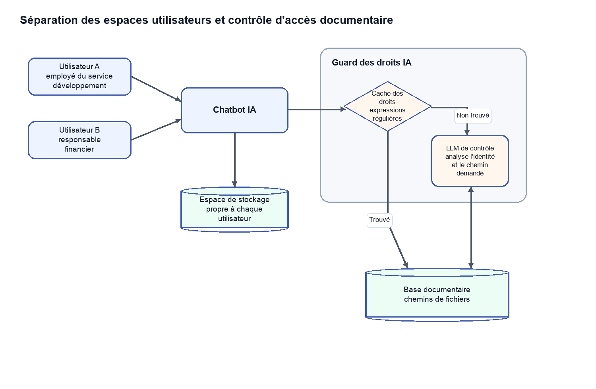
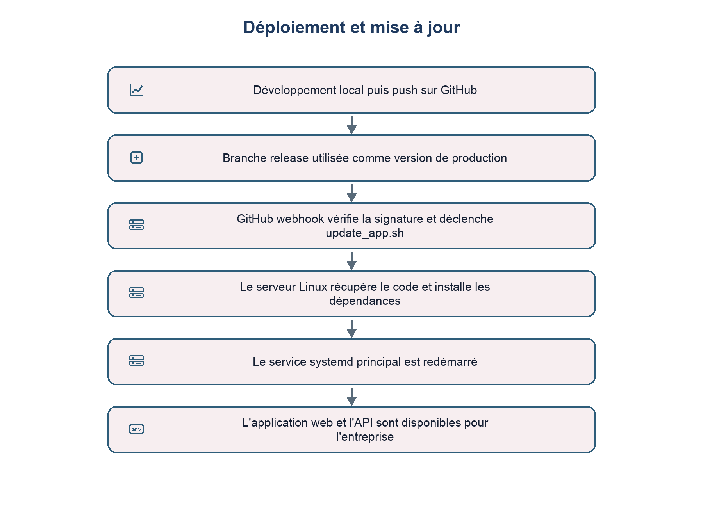

During my full-stack AI internship at Fuzhou Shangbo Software Co., Ltd., I developed AI features for an existing pharmacy and retail ERP. Working directly with the company director, I translated business needs into three modules: store diagnostics, price recommendations and an AI customer-support agent.

## Three business modules

- Store diagnostics — Import ERP exports, including archives, or retrieve data through APIs. Explore heterogeneous files, structure tabular data and calculate indicators. Produce a detailed Markdown report and concise JSON diagnostic cards linking findings to evidence and suggested actions.
- Price recommendations — Check input suitability, align product and sales data, and prepare price–volume observations. Python calculates revenue and, when purchase cost is available, profit; the interface presents charts and structured recommendations. In the current public implementation, candidates are ranked from normalized observations, rather than establishing a universally optimal price.
- AI customer support — Combine conversation history, user-provided files and controlled access to service documentation. Use tools and ERP APIs to assist with tasks such as preparing data imports from a previous ERP. Account-level file spaces and scoped service authorization frame access and actions.

## System architecture

- Web interface & API — The browser uploads files, starts jobs and retrieves results through FastAPI. Long-running jobs expose status and SSE progress logs, with history and cancellation controls.
- Agent orchestration — A custom AgentLoop uses the OpenAI SDK and configurable compatible model endpoints. It coordinates tool calls and a work plan inside a run workspace, separating input files, intermediate artifacts and outputs.
- Data & delivery — Python, Pandas and DuckDB support file processing and analytical work. Structured JSON connects backend outputs to the UI; Linux, Uvicorn, systemd and Nginx support deployment. GitHub-based update automation forms part of the operational workflow.

## My contribution

- Requirements & design — Discussed expected user results with the director, broke the work into import, processing, output, interface and deployment stages, and iterated on demonstrations and feedback.
- Full-stack development — Worked independently across backend APIs, agent tools and workflows, data preparation, and web interfaces for the three modules. Added practical features including execution history, progress logs and structured result views.
- Integration & operations — Connected workflows to ERP APIs, worked on account-based file separation and authorization, deployed to the company’s Linux server and contributed to installation and update automation.

## Technical scope & evolution

The internship report describes HTML/CSS/JavaScript interfaces and a Python/FastAPI backend. The public repository now includes a Vue frontend. This page distinguishes the internship responsibilities from the repository’s subsequent evolution; the linked code is a living project, not a frozen internship snapshot.

## Engineering lessons & limits

I learned to keep numerical calculations and access checks in program code, while using the language model to interpret files and explain results. Heterogeneous exports required exploration before processing and explicit output contracts. Price recommendations remain a decision-support prototype: sparse observations, promotions and data quality limit confidence. Deployment does not establish measured business impact.

## Public presentation

This overview presents general engineering work and links to the public source repository. Company documents, customer datasets, credentials, internal API details and production access are excluded. The screenshots and diagrams on this page come from my internship report.
