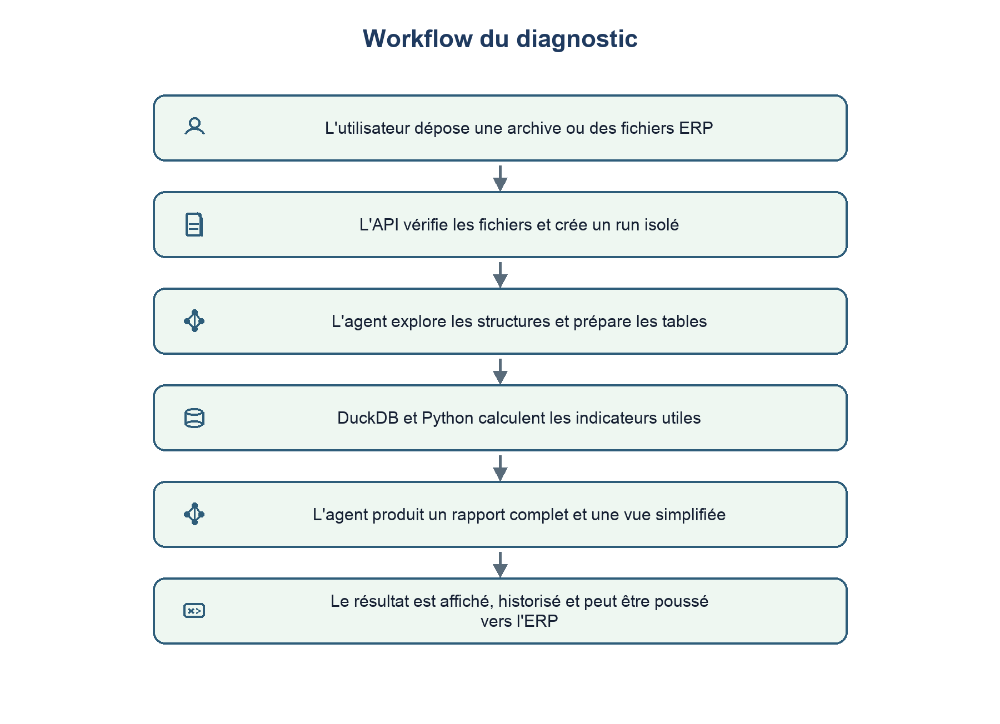
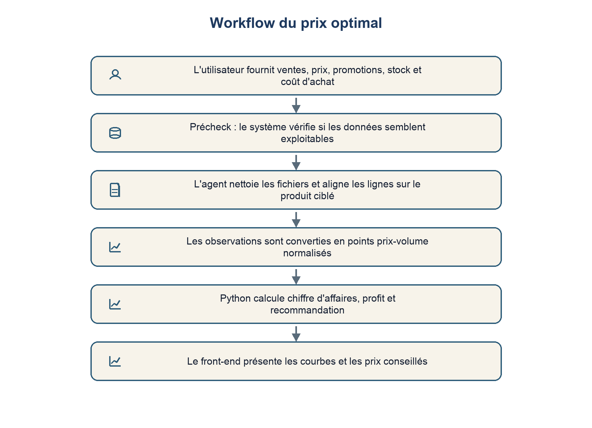
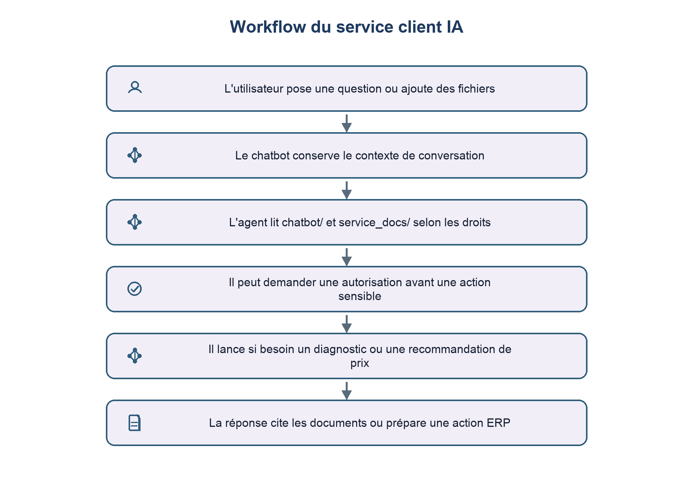
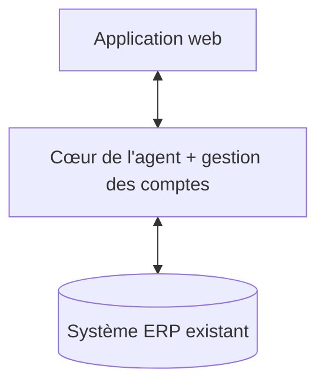
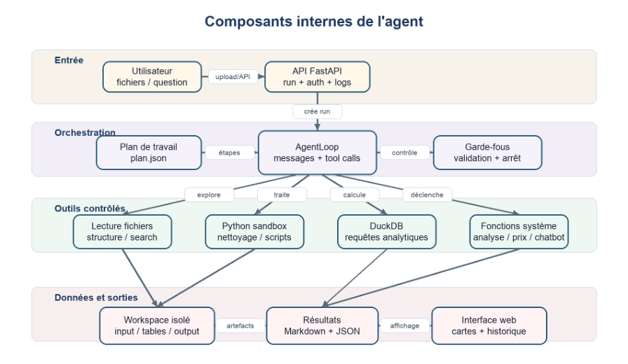
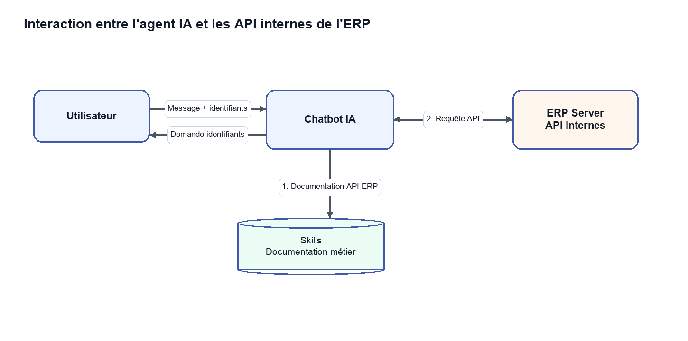
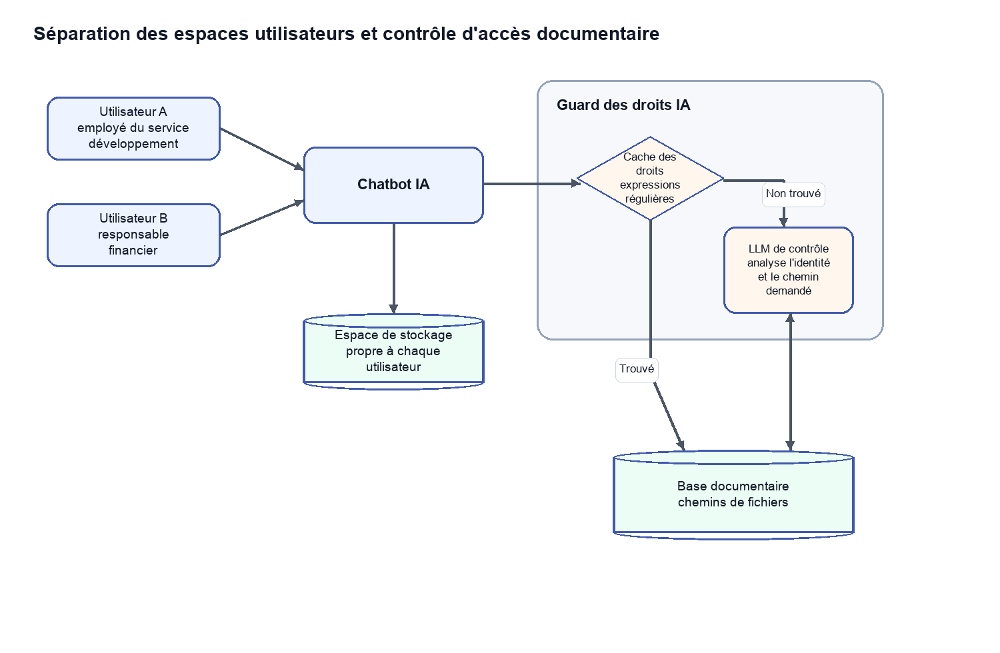
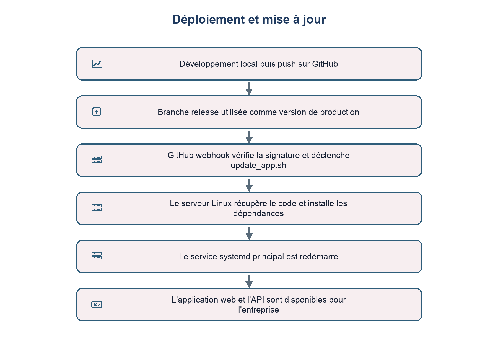

Pendant mon stage de développement full-stack IA chez Fuzhou Shangbo Software Co., Ltd., j’ai développé des fonctionnalités IA pour un ERP existant destiné aux pharmacies et aux commerces. En lien direct avec le dirigeant, j’ai traduit les besoins métier en trois modules : diagnostic de magasin, recommandation de prix et agent IA de support client.

## Trois modules métier

- Diagnostic de magasin — Importer des exports ERP, y compris des archives, ou récupérer des données par API. Explorer les fichiers hétérogènes, structurer les tables et calculer les indicateurs. Produire un rapport Markdown et des cartes JSON associant constats, preuves et pistes d’action.
- Recommandation de prix — Vérifier les fichiers, rapprocher les données produit et ventes, puis préparer les observations prix-volume. Python calcule le chiffre d’affaires et, si le coût d’achat est connu, le profit ; l’interface affiche graphiques et recommandations structurées. L’implémentation publique actuelle classe les candidats à partir des observations normalisées, sans établir un prix universellement optimal.
- Agent IA de support — Combiner historique de conversation, fichiers utilisateur et accès contrôlé à la documentation de service. Utiliser des outils et les API ERP pour accompagner des tâches comme la préparation d’imports depuis un ancien ERP. Les espaces de fichiers par compte et les autorisations de service limitées encadrent les accès et les actions.

## Architecture du système

- Interface web et API — Le navigateur transmet les fichiers, lance les tâches et récupère les résultats via FastAPI. Les traitements longs exposent un état et des logs de progression SSE, avec historique et arrêt possible.
- Orchestration de l’agent — Une boucle AgentLoop spécifique utilise le SDK OpenAI et des points d’accès compatibles configurables. Elle coordonne appels d’outils et plan de travail dans un workspace par exécution, séparant entrées, fichiers intermédiaires et sorties.
- Données et livraison — Python, Pandas et DuckDB servent au traitement des fichiers et à l’analyse. Des sorties JSON relient backend et interface ; Linux, Uvicorn, systemd et Nginx assurent le déploiement. Une mise à jour automatisée depuis GitHub complète l’exploitation.

## Ma contribution

- Besoins et conception — Échanges avec le dirigeant sur les résultats attendus, découpage en étapes d’import, traitement, restitution, interface et déploiement, puis itérations à partir des démonstrations et retours.
- Développement full-stack — Travail en autonomie sur les API backend, les outils et workflows de l’agent, la préparation des données et les interfaces web des trois modules. Ajout de l’historique, des logs de progression et des vues de résultats structurées.
- Intégration et exploitation — Connexion aux API ERP, séparation des fichiers et autorisations par compte, déploiement sur le serveur Linux de l’entreprise et travail sur l’installation et les mises à jour automatisées.

## Périmètre technique et évolution

Le rapport de stage décrit des interfaces HTML/CSS/JavaScript et un backend Python/FastAPI. Le dépôt public comprend aujourd’hui un frontend Vue. Cette page distingue les responsabilités du stage de l’évolution ultérieure du dépôt : le code lié reste un projet vivant, et non un instantané figé du stage.

## Enseignements et limites

J’ai appris à confier les calculs numériques et les contrôles d’accès au programme, en utilisant le modèle pour interpréter les fichiers et expliquer les résultats. Les exports hétérogènes nécessitent une exploration préalable et des contrats de sortie explicites. La recommandation de prix reste un prototype d’aide à la décision : peu d’observations, les promotions et la qualité des données limitent sa fiabilité. Le déploiement ne démontre pas un impact métier mesuré.

## Présentation publique

Cette présentation expose le travail technique général et renvoie au code public. Elle exclut documents d’entreprise, données clients, identifiants, détails d’API internes et accès de production. Les captures et schémas de cette page sont tirés de mon rapport de stage.
