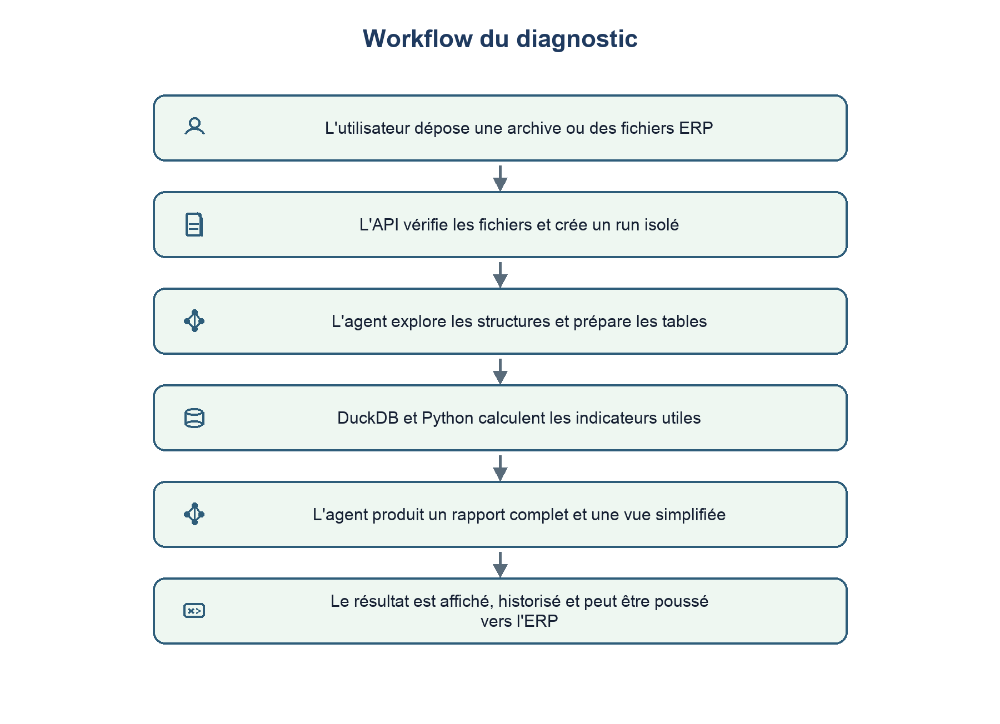
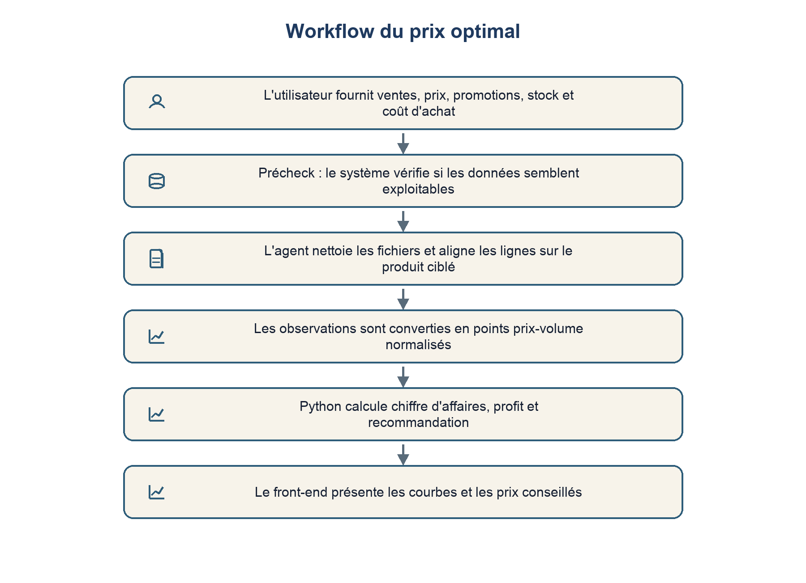
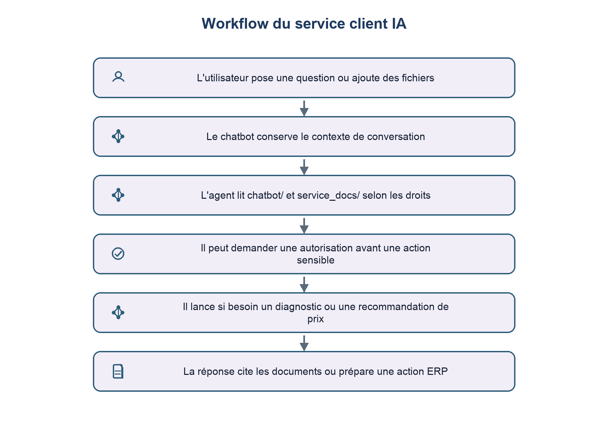
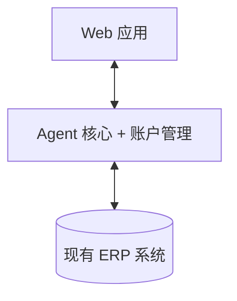
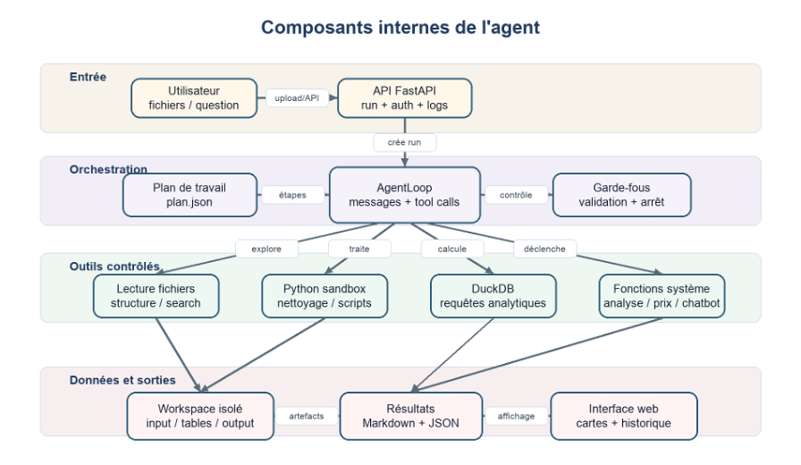
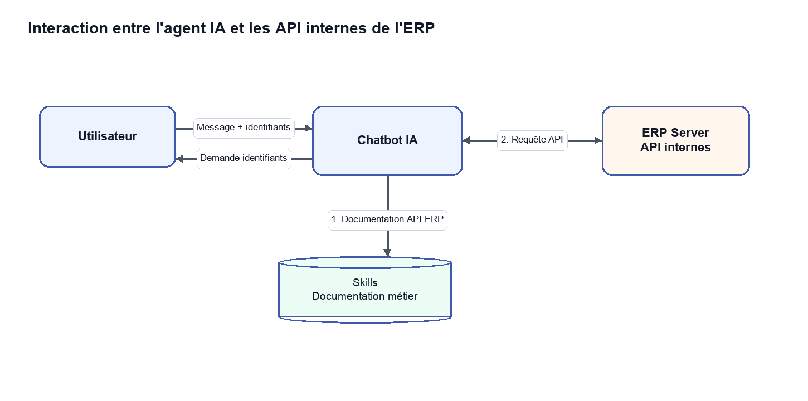
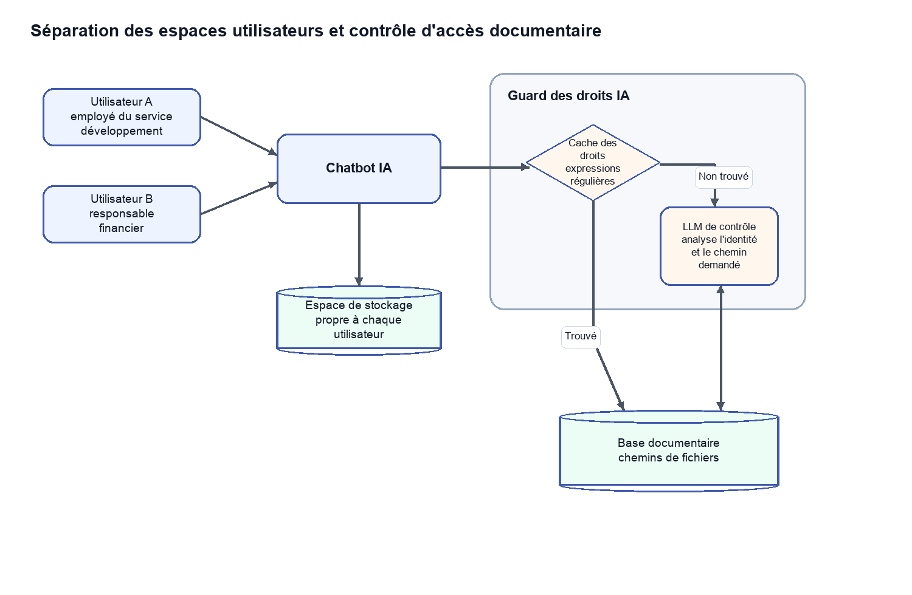
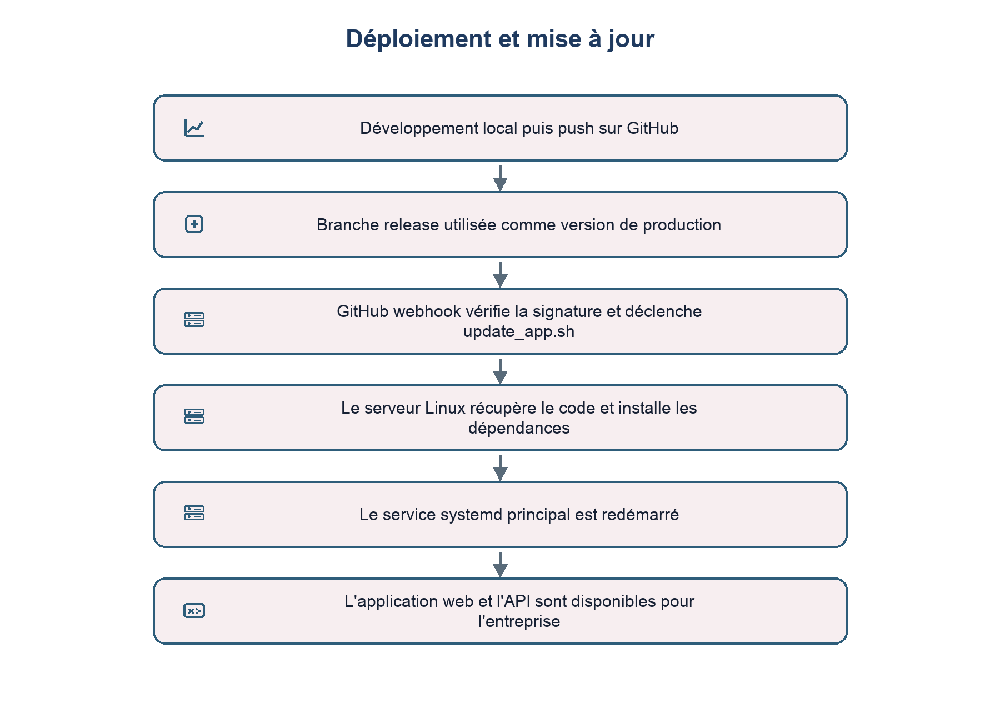

在福州商搏软件有限公司担任全栈 AI 开发实习生期间，我为现有药店及零售 ERP 开发 AI 功能。我直接与企业负责人沟通需求，围绕门店经营诊断、价格推荐和 AI Agent 客服三个模块完成开发。

## 三个业务模块

- 门店经营诊断——导入 ERP 导出文件（含压缩包）或通过 API 获取数据；探索异构文件、整理表格并计算指标，输出完整 Markdown 报告与 JSON 诊断卡片，将问题、数据依据和改进建议关联起来。
- 价格推荐——预检文件是否可用，对齐商品与销售数据，整理价格—销量观测点。由 Python 计算销售额，并在有进货成本时计算利润；界面展示图表与结构化建议。当前公开实现基于归一化观测点排序候选价格，推荐结果不代表普遍适用的最优售价。
- AI Agent 客服——结合会话历史、用户上传文件与受控的服务文档访问，通过工具和 ERP API 辅助处理业务任务，例如准备旧 ERP 数据导入。以账号文件空间及范围受限的服务授权约束数据访问与操作。

## 系统架构

- Web 界面与 API——浏览器通过 FastAPI 上传文件、启动任务并获取结果。长任务提供状态与 SSE 进度日志，配套历史记录及取消操作。
- Agent 编排——自定义 AgentLoop 通过 OpenAI SDK 连接可配置的兼容模型接口，在单次运行的 workspace 内组织工具调用与工作计划，并区分输入、处理中间产物与输出。
- 数据处理与交付——使用 Python、Pandas 和 DuckDB 处理文件与分析数据，以结构化 JSON 对接前后端；通过 Linux、Uvicorn、systemd 和 Nginx 部署，并参与基于 GitHub 的自动更新流程。

## 我负责的工作

- 需求与设计——与企业负责人讨论用户期望的结果，将功能拆解为导入、处理、产出、界面和部署阶段，通过演示与反馈持续迭代。
- 全栈开发——独立承担三个模块的后端 API、Agent 工具与工作流、数据准备和 Web 界面开发，补充运行历史、进度日志和结构化结果展示等实用功能。
- 集成与运维——对接 ERP API，处理基于账号的文件隔离和授权，将模块部署至企业 Linux 服务器，并完成安装与自动更新相关工作。

## 技术范围与版本演进

实习报告记录了 HTML/CSS/JavaScript 界面与 Python/FastAPI 后端；当前公开仓库包含 Vue 前端。本页区分实习职责与仓库后续演进，链接代码为持续发展的项目，并非冻结的实习交付快照。

## 工程思考与局限

我学会将数值计算与访问检查交给程序实现，让语言模型负责理解文件和解释结果。面对格式不一的导出文件，需要先探索结构，再处理数据，并约定明确的输出格式。价格推荐仍是辅助决策原型，观测点不足、促销和数据质量都会限制可信度；完成部署也不等于已经验证业务收益。

## 公开展示范围

本页仅介绍通用技术工作并链接公开源码，不公开企业文档、客户数据、凭据、内部 API 细节或生产访问入口。本页的截图和流程图取自我的实习报告。
